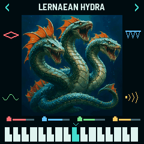

# ABYSS-1 · Monster Keys

**[Play Monster Keys 2.0.1](https://joakimeriksson.github.io/fm1-emu/?package=https%3A%2F%2Fraw.githubusercontent.com%2Fcofab-apps%2Fabyss-1%2Fmain%2Fbuilds%2Fabyss-1-monster-keys-2.0.1.fwsc&name=ABYSS-1%20Monster%20Keys&embed=1&mhz=60)** · [Download the FM-1 firmware](builds/abyss-1-monster-keys-2.0.1.fwsc) · [Watch and hear four monster calls](evidence/monsters/monster-calls-2.0.1.mp4)

Tap **Start**. Hydra appears on the FM-1 screen. Hold a white key and slowly turn the first knob to hear its mouth open. Keep the note held and touch the raised key beside it to bend the call. Turn **SELECT** to hear the next monster introduce itself.

## What you can play today

| On the FM-1 | What happens in 2.0.1 |
|---|---|
| SELECT or PRESETS | Browse 20 illustrated sea monsters. Each has its own call and starting knob settings. |
| Keyboard | Play a melody or up to four notes of the selected monster. White keys follow a pentatonic scale. Paired raised keys bend a held note. |
| Four knobs | **Mouth** shapes vowels, **Teeth** adds edge, **Wobble** moves the pitch, and **Cave** adds stereo echoes. The matching symbols beside the portrait change as you turn. |
| REC | Arm a take. The first note or audition starts the clock. Play, change monster or turn knobs, then press REC again to finish. |
| PLAY | Play the take once, including rests and gestures. With an empty recorder, PLAY auditions the current monster. A take lives in memory until power-off. |

## Proposed next instrument · Monster Choir

Give four monsters a place on screen and a shared **32-step loop**. One key could make the whole choir sing immediately. REC could then give each singer its own tune. For example, record two low Bloop notes, add a tapping Crab, then let Hydra sing a long answer while the first two repeat. A fourth singer can join whenever the child is ready.

The proposed controls, two-bar recording flow and acceptance checks are in the [choir design](docs/backlog.md). The playable firmware above is the solo instrument with one-shot recording.

[Player guide](docs/MANUAL.md) · [All 20 portraits](monster-keys/bestiary.png) · [Build and verification](docs/MONSTER-KEYS.md) · [Credits](LICENSING.md)

Created by Gabor Varga, Zurich. The instrument runs on fm1-base. The browser player uses Joakim Eriksson’s FM-1 emulator.
