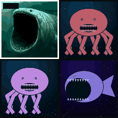

# ABYSS-1

ABYSS-1 is a four-track musical instrument in development for the M-VAVE FM-1. A child picks a sea creature, plays its voice, and layers a loop. Portraits and sound provide the cues for players who cannot yet read.

**Project creator and maintainer:** Gabor Varga · Zurich, Switzerland. Firmware base: Optimist on fm1-base. Browser emulator: Joakim Eriksson’s fm1-emu.

## Try the current build

**[Play ABYSS-1 in the FM-1 simulator](https://abyss-one-fm1-simulator.aware-field-4307.chatgpt.site/?fw=abyss-1&embed=1&mhz=60)**

Tap **Start**. The FM-1 screen opens on Bloop, Kraken, Julia and Space Bloop. Play the keys, then turn **SELECT** to hear another creature. Tap **REC**, play a phrase, turn **SELECT** and add a second part. Tap **REC** again to end recording. **PLAY** stops and restarts the loop.

This build has 16 portraits, 16 initial patches, four freely assignable tracks and a 16-step loop. The bass family uses four-operator FM, percussion uses resonant noise, vocals use a formant synth and atmosphere uses a detuned string ensemble. Key pressure and physical FM-1 testing are outstanding. Bluetooth and Wi-Fi are disabled.

[Player guide](docs/MANUAL.md) · [Hardware used](docs/HARDWARE.md) · [Acceptance tests](evidence/creature-tests.log) · [Original browser prototype](https://abyss-one-fm1-simulator.aware-field-4307.chatgpt.site/creatures/index.html)

## Build and contribute

- [Building and testing](BUILDING.md) covers the firmware build configurations, Mac setup and regression commands.
- [Architecture decision](docs/discovery.md) records the Optimist and fm1-base selection, flash and RAM budgets, display format and hardware recovery research.
- [Contributing](CONTRIBUTING.md) describes where changes belong and how to report a playback issue.
- [Credits and licensing](LICENSING.md) links the upstream notices and character provenance.

The firmware wrapper pins Optimist at `d1fbcf9`. Source revisions, local test results and build measurements are available in the [source lock](docs/sources.lock) and [evidence directory](evidence/).
