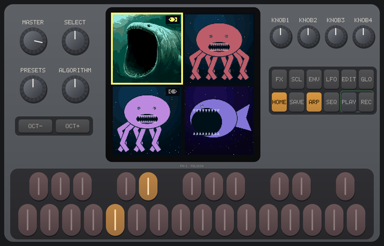
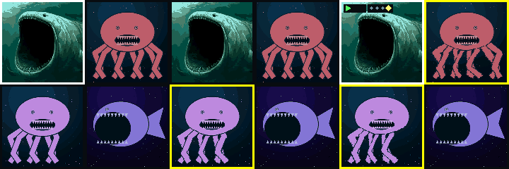

# ABYSS-1

**[Play Monster Keys 2.0.1 in your browser](https://joakimeriksson.github.io/fm1-emu/?package=https%3A%2F%2Fraw.githubusercontent.com%2Fcofab-apps%2Fabyss-1%2Fmain%2Fbuilds%2Fabyss-1-monster-keys-2.0.1.fwsc&name=ABYSS-1%20Monster%20Keys&embed=1&mhz=60)** · [Firmware](builds/abyss-1-monster-keys-2.0.1.fwsc) · [See and hear four monsters](evidence/monsters/monster-calls-2.0.1.mp4)

Tap **Start**. The three-headed Hydra is already an instrument. Hold any piano key and turn the first coloured knob to open its mouth. Turn **SELECT** to find a teeth-clicking Crab, the deep Bloop or a Space Bloop whose voice breaks into a radio transmission. Turning a sound knob with both hands off the keys makes the creature call once.

The four knobs shape **Mouth**, **Teeth**, **Wobble** and **Cave**. The symbols around the portrait change with the knobs. The little keyboard and the panel lights show where to play. **REC** captures a performance, including knob movements. Press **REC** again to finish, then **PLAY** to hear it. The take lasts for the current power session.

The raised keys are finger bends for their neighbouring white notes. Hold a white key and rock onto the raised key beside it: the same voice bends and brightens without stealing another note from a chord.

[Player guide, reproducible build and simulator checks](docs/MONSTER-KEYS.md) · [All twenty portraits](monster-keys/bestiary.png)

Project creator and maintainer is Gabor Varga, Zurich, Switzerland. Monster Keys runs directly on fm1-base. Joakim Eriksson’s fm1-emu runs the target firmware in the browser.

## Play or recover a Beta 1.5 song

**[Open ABYSS-1 in the FM-1 simulator](https://joakimeriksson.github.io/fm1-emu/?package=https%3A%2F%2Fraw.githubusercontent.com%2Fcofab-apps%2Fabyss-1%2Fmain%2Fbuilds%2Fabyss-1-beta-1.5.fwsc&name=ABYSS-1&embed=1&mhz=60)** · [Download the firmware](builds/abyss-1-beta-1.5.fwsc) · [Watch and hear a Reef Reply become a song](evidence/duet/reef-duet.mp4)

Tap **Start** and pause for a moment. Two fish and the bright frame take turns while the ARP button pulses, inviting you into the game without words. Tap **ARP** and play three keys. Lift your fingers. A second creature lights up and plays your phrase back in its own voice. Watch the keys you just played light up in the same rhythm under the answering creature. When the PLAY lamp pulses, press it to keep the exchange as a real loop: your call fills the first half and the other creature answers in the second.

Press **PLAY** before playing a call to hear the band. On a fresh song Bloop, Kraken, Julia and Space Bloop play a bar together. The moving jaws and tentacles show who is sounding. Four pearls across the top count the beats.

To make your own music, start with **REC** and play a key. Select another creature to overdub it. On HOME, **EDIT** lifts the last take. Press **EDIT** again to bring it back. If you started with the quartet, you can lift all four factory parts in one press.

Try the low and high keys on Kraken. Low strikes have a falling, tuned body. High keys produce a short shell rattle. All 16 creatures respond to notes from the keyboard, MIDI and the sequencer. The four family engines are FM bass, percussion, formant voice and detuned strings.

[Player guide](docs/MANUAL.md) · [Beta 1.5 verification](docs/BETA-1.5.md) · [Hear the quartet](evidence/reef/abyss-1-beta-1.3.mp4) · [Hardware](docs/HARDWARE.md) · [Original browser prototype](prototype/abyss1/)

## Build and contribute

- [Building and testing](BUILDING.md) covers the firmware build configurations, Mac setup and regression commands.
- [Architecture decision](docs/discovery.md) records the Optimist and fm1-base selection, flash and RAM budgets, display format and hardware recovery research.
- [Contributing](CONTRIBUTING.md) describes where changes belong and how to report a playback issue.
- [Credits and licensing](LICENSING.md) links the upstream notices and character provenance.

The firmware wrapper pins Optimist at `d1fbcf9`. Source revisions, local test results and build measurements are available in the [source lock](docs/sources.lock) and [evidence directory](evidence/).
