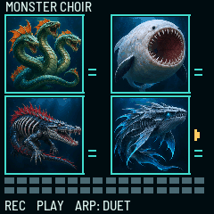

# ABYSS-1 · Monster Choir 2.1

**[Play Monster Choir](https://joakimeriksson.github.io/fm1-emu/?package=https%3A%2F%2Fraw.githubusercontent.com%2Fcofab-apps%2Fabyss-1%2Fmain%2Fbuilds%2Fabyss-1-monster-choir-2.1.0.fwsc&name=ABYSS-1%20Monster%20Choir&embed=1&mhz=60)** · [Download the firmware](builds/abyss-1-monster-choir-2.1.0.fwsc) · [Watch and hear the duet](evidence/choir/duet.mp4)

Tap **Start**, press **ARP**, then play two notes and lift your fingers. Hydra sings your call. In the second bar Bloop sings it back. When the arrow returns, try another rhythm. Press **PLAY** to finish the exchange.

The screen shows four of the 20 portraits made for Monster Keys from Gabor Varga’s descriptions. His visual reference was MetaVine Labs’ [Legendary Sea Monsters 2025](https://www.youtube.com/watch?v=VciSINFWAzw). [Portrait atlas, SCP creator credits and artwork licence](LICENSING.md).

| To play | On the FM-1 |
|---|---|
| Build a choir | HOME opens four portrait seats. SELECT moves the yellow marker. Turn PRESETS to audition, then press SEL/SCL to invite that singer. |
| Hear a chord | With transport stopped, hold one white key. The occupied seats add root, fifth, third and low octave. Each sounding monster lights up. |
| Make a repeating song | REC arms one singer. The first note starts two bars. Your phrase repeats after 32 steps. Arm another seat to join on the next downbeat. PLAY stops or restarts them together. EDIT undoes the most recent take. |
| Keep a favourite | In the choir, SAVE keeps one complete arrangement. During playback a save waits for STOP and key release. GLO recalls it while stopped. The next boot restores it when you enter the choir. |
| Whisper and growl | Hold a white note and rock onto its paired raised key. The bend grows into a growl over 0.7 seconds. On the FM-1, press ENV with all keys up to enable continuous finger pressure on the lower 20 keys. |

**Hardware.** Monster Choir 2.1.0 booted on a physical M-VAVE FM-1 with Puya P25Q80 flash after installation from stock 015. Gabor played notes, browsed portraits and brought up Bloop’s Wobble control. Four-part playback and favourite recall after a restart passed in the simulator on both flash models. The UC25HQ80 still needs a physical test. [Compatibility results](docs/MONSTER-KEYS.md#fm-1-hardware-compatibility).

[Player guide](docs/MANUAL.md) · [Verification and limitations](docs/MONSTER-KEYS.md) · [Rebuild](BUILDING.md) · [All 20 portraits](monster-keys/bestiary.png) · [Credits](LICENSING.md)

Created by Gabor Varga, Zurich. Built on fm1-base. Browser player by Joakim Eriksson.
