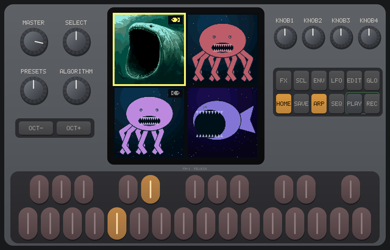

# ABYSS-1 Beta 1.4.1 · Play it back by sight

[Play the instrument](https://joakimeriksson.github.io/fm1-emu/?package=https%3A%2F%2Fraw.githubusercontent.com%2Fcofab-apps%2Fabyss-1%2Fmain%2Fbuilds%2Fabyss-1-beta-1.4.1.fwsc&name=ABYSS-1&embed=1&mhz=60) · [Download firmware](../builds/abyss-1-beta-1.4.1.fwsc) · [See and hear the keyboard answer](../evidence/keylights/reef-keylights.mp4)

On the four portraits, press **ARP** and play a phrase. The keys light under your fingers. When the other creature takes its turn, the same keys light in your original rhythm, even if its voice sounds an octave away. Watch the keys, then play the phrase back to it. Rests leave the keys dark. A new note takes the turn back immediately.



An earlier release could hear a chord as a string of separate notes when fingers landed on different keyboard scans. It passed a test that pressed the three keys at exactly the same instant. Playing the same chord with the fingers 9 ms apart exposed the fault. The firmware now groups overlapping strikes in the first 45 ms and keeps their first onset. Releasing one key before the next attack still makes a new note.

The target was exercised with a three-note minor chord spread across 17 ms. Its answer contained all three fundamentals. A second pair of taps, released and re-struck about 38 ms apart, remained distinct. In a separate run the scanned LED matrix showed two specific keys during a chord, both again during the reply, darkness through the rest and a different single key for the following note. All four default pairings passed the three-key exercise without missed audio refills.

Two Linux builds, including a fresh target build under a different absolute path using the pinned compiler and SDK cache, produced identical package bytes. Build ID `E8ED944C`. The application occupies 610,208 of 823,228 flash bytes and 209,232 of 486,144 static SRAM bytes.

The factory quartet played for 600.135 emulated seconds at 60 MHz, over 206,848 DAC blocks of 128 frames, with zero misses or second-core faults. A saved Beta 1.4 song survived a flash-sector restore into this firmware.

The film uses the emulator’s panel renderer, the firmware’s 240 × 240 LCD and scanned key lights, and its original stereo DAC stream. To reproduce the panel recording, run the following command after building the firmware. For a portable video, feed `reply-panel.rgba` to FFmpeg as 1280 × 820 RGBA at 10 fps and `reply.s16` as stereo signed 16-bit PCM at 44.1 kHz.

```sh
ABYSS_PANEL_FILM=1 node scripts/test-performance.mjs simulator builds/abyss-1-beta-1.4.1.fwsc out/film --reply
```

[Regression measurements](../evidence/keylights/verification.txt) · [Build instructions](../BUILDING.md#beta-141-keyboard-regression) · [Reef Reply and the recording controls](BETA-1.4.md)

The scan and sound measurements are from emulation. Physical LED brightness, onboard speaker balance and how quickly a child discovers the controls still need an in-person session.
