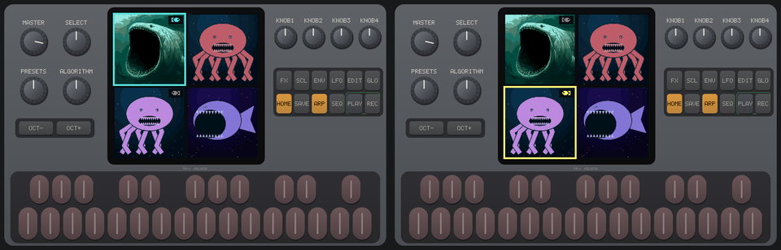

# ABYSS-1 Beta 1.4.2 · The reef invites you

[Play Beta 1.4.2](https://joakimeriksson.github.io/fm1-emu/?package=https%3A%2F%2Fraw.githubusercontent.com%2Fcofab-apps%2Fabyss-1%2Fmain%2Fbuilds%2Fabyss-1-beta-1.4.2.fwsc&name=ABYSS-1&embed=1&mhz=60) · [Download the firmware](../builds/abyss-1-beta-1.4.2.fwsc) · [Watch and hear Reef Reply](../evidence/keylights/reef-keylights.mp4)

Start a fresh instrument and wait. Bloop and Julia take turns after five seconds. Their little fish and the frame around each portrait alternate while ARP pulses on the panel. Press ARP, play a short phrase, and the second creature answers in its own voice. The invitation uses motion, colour and a physical lamp because the intended player may not read yet.

## Behaviour

The invitation appears only on stopped HOME with an empty song. It waits until the firmware has been running for five seconds and the player has been idle for at least 4.2 seconds. The turn changes every 550 ms. Any key, button or encoder movement clears it immediately. It can return after another quiet pause until ARP is tried. After that it remains dismissed for the session. A restored song and the factory band never receive it.

The invitation reuses Reef Reply’s cyan caller, gold responder and two fish. Entering the game therefore changes behaviour without changing its visual vocabulary. The current creature pair remains playable throughout. No text is added to the 240 × 240 screen.

## Verification

- The firmware test observed both fish, both coloured portrait frames and the ARP lamp. It then entered and left Reef Reply, waited longer than the invitation delay and verified that the hint stayed dismissed. A recorded step was saved, the firmware rebooted from its changed flash sectors, and the restored song remained free of the invitation.
- Touch Chromium loaded the exact local package, observed both real-time invitation frames, entered ARP from the rendered panel, played a touch key, received audible DAC output from the partner, returned control to the player, and then started and stopped the factory quartet.
- The complete Reef Reply test passed at 60 and 100 MHz. The release package retained the staggered three-finger chord, distinct rapid taps, echoed key lights, interruption, cancellation and recording isolation from Beta 1.4.1.
- The factory quartet ran for 600.135 emulated seconds at 60 MHz. It completed 206,848 groups of 128 frames with zero missed refills and zero second-core faults. A song created by Beta 1.4.1 loaded and played after its saved flash sectors were restored into this release.
- Two Linux cross-builds produced identical package bytes. The second used a fresh target build directory under a different absolute project path with cached pinned compiler and SDK inputs. Firmware ID `CA27B8DE`. Application flash is 610,588 of 823,228 bytes. Static SRAM is 209,236 of 486,144 bytes.

[Raw verification record](../evidence/invitation/verification.txt) · [Reproduce the release](../BUILDING.md#beta-142-invitation-regression) · [Player guide](MANUAL.md) · [Previous release](BETA-1.4.1.md)

Physical LED brightness, onboard speaker balance and unprompted discovery by children remain untested. The simulator demonstrates the intended cue and timing. It does not establish how quickly a first-time child will interpret them.
