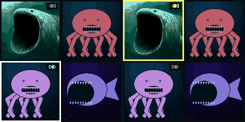

# ABYSS-1 Beta 1.4 · Reef Reply

[Play Beta 1.4](https://joakimeriksson.github.io/fm1-emu/?package=https%3A%2F%2Fraw.githubusercontent.com%2Fcofab-apps%2Fabyss-1%2Fmain%2Fbuilds%2Fabyss-1-beta-1.4.fwsc&name=ABYSS-1&embed=1&mhz=60) · [Download the firmware](../builds/abyss-1-beta-1.4.fwsc) · [Hear Julia call and Bloop answer](../evidence/reply/reef-reply.mp4)

Press **Start → ARP** on the four portraits. Play a little rhythm and lift your fingers. The creature opposite yours repeats it in its own voice and register. Play during the answer to take your turn back. Try swapping caller and responder with SELECT. Press PLAY for the band or REC to make your own loop.

## How the game feels

The partner waits for a breath after the last key is released. The pause follows tempo, between 300 and 620 ms. A held note keeps the turn with the child. Notes struck together share a gate. Short attacks, held tones and rests survive the handoff. Eight attacks fit in one phrase. The gate limit is 2.2 seconds per attack and the last attack can start up to eight seconds after the first. A ninth held key still gets a breath before the answer begins.

The filled fish and the whole answering tile show who has the turn. An early version used two tiny fish alone. Looking at the actual FM-1 screen showed how little of the portrait changed when the turn moved across the panel. The released version transfers the bright frame too. The underlying pictures still react to the synth voices.

Practice uses a separate short-lived phrase in memory. Recording, saving, changing screens and switching partners cancel the pending answer. The sequencer never receives the practice notes. Keyboard and onscreen panel keys can lead the game. External MIDI retains its normal performance role.

## What was exercised

- With a muted Julia, only Bloop reached the DAC. Three returned pitches were identified in order from the audio, with the player’s inter-onset spacing. A simultaneous C-minor triad returned all three expected fundamentals. On the default song the partner’s lit frame appeared 418 ms after the last release in the measured phrase.
- Tested interruption by a new note, cancelling with ARP, holding a ninth key after filling the phrase, changing partner mid-phrase, and switching directly to recording. Practice left the sequencer empty. A subsequent REC take contained the new note on the player’s track.
- Three-key calls and replies on all four default track pairings met every sampled DAC refill deadline at 60 MHz. Touch Chromium exercised the visible ARP button and keyboard, the listening and answering fish, audio output, and return to the factory quartet. A separate touch run recorded two parts, saved, reloaded the page and replayed them.
- A ten-minute factory quartet run at 60 MHz completed 206,848 blocks of 128 frames with zero missed refills and zero second-core faults. All 16 creatures produced sound on each of the four tracks. All 120 pairs separated on gain-normalized time/frequency profiles. A song saved in Beta 1.3 survived a flash-sector restore into Beta 1.4.
- The performance clip contains 273,920 stereo frames taken at 44.1 kHz from the running firmware. Peak magnitude was 0.154 of full scale. Frames in the preview are enlarged with nearest-neighbour scaling.
- The package uses 610,056 of 823,228 application flash bytes and 209,184 of 486,144 available static SRAM bytes. Its build ID is `90C1598A`. Three cross-builds produced byte-identical packages, including one under a different path with fresh target build directories and cached compiler and SDK inputs.

[Results](../evidence/reply/verification.txt) · [Build and test commands](../BUILDING.md#beta-14-release-checks) · [Player guide](MANUAL.md) · [Previous release](BETA-1.3.md)

The next open product question is whether a first-time player can find Reef Reply without someone naming the ARP button. An idle pictogram or a one-time visual invitation can be tried against the existing quiet, immediately playable HOME. Physical speaker balance, real key feel and discovery by children still need an in-person session. Browser storage is specific to the firmware package. An existing browser song stays accessible through the link for its original version.
