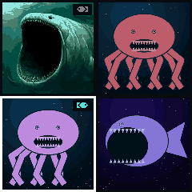
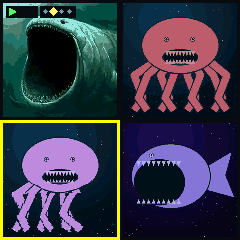

# ABYSS-1 Beta 1.5 · Make the answer a song

[Play Beta 1.5](https://joakimeriksson.github.io/fm1-emu/?package=https%3A%2F%2Fraw.githubusercontent.com%2Fcofab-apps%2Fabyss-1%2Fmain%2Fbuilds%2Fabyss-1-beta-1.5.fwsc&name=ABYSS-1&embed=1&mhz=60) · [Download the firmware](../builds/abyss-1-beta-1.5.fwsc) · [Watch and hear the duet](../evidence/duet/reef-duet.mp4)

Reef Reply no longer ends as a disposable exercise. Play a short call and hear the partner answer. When the PLAY lamp pulses, press it: the child’s rhythm becomes the first half of a one-bar song and the other creature answers in the second half. The loop starts immediately, with the existing animated portraits and beat pearls showing the result.

The relative timing and note lengths are fitted into eight steps for each turn. Up to eight attacks and four-note chords are retained. The answer keeps the partner’s register, patch and release. A new key replaces the finished practice phrase; ARP discards it. EDIT removes or restores both sequencer tracks as one musical gesture, and SAVE retains the result across restart.

Safety is explicit. Conversion is allowed only when every sequencer track is empty. If a child already has a song, PLAY leaves Reef Reply and starts that song without adding or replacing a note.

## Verification

- The 60 and 100 MHz chip simulations captured a three-note call at steps 0, 3 and 5 and its response at 8, 11 and 13. The kept duet was audible from the stereo DAC; the two unused tracks remained empty.
- One HOME / EDIT gesture removed both halves and the next restored them. SAVE and a full simulated chip reboot restored the same caller and partner patterns.
- A pre-existing song remained unchanged after a complete practice exchange and PLAY. The Beta 1.4.2 saved-song sectors also restored and played in this firmware.
- The full four-track factory arrangement ran for 600.135 emulated seconds at 60 MHz: 206,848 groups of 128 DAC frames, zero missed refills and zero second-core faults.
- All sixteen creatures, all 64 track/creature assignments, 120 pairwise voice comparisons, recording, step entry, mute/solo, LFO, FX and physical-key expression regressions passed.
- Two cross-builds produced byte-identical packages, including a fresh target directory under a different absolute project path. Build `D81D7D09` uses 611,244 of 823,228 application-flash bytes and 209,236 of 486,144 static-SRAM bytes. Package SHA-256: `b763c8354a737294ce0d3268d3d5ea736b50c49f953a009769a414ef51c43156`.

[Reproduce the release](../BUILDING.md#beta-15-duet-regression) · [Player guide](MANUAL.md) · [Previous release](BETA-1.4.2.md)

The simulator verifies the native LCD, scanned panel lamps, timing and actual stereo DAC stream. Physical button brightness, onboard-speaker balance and first-time child behaviour still require an FM-1 playtest.
