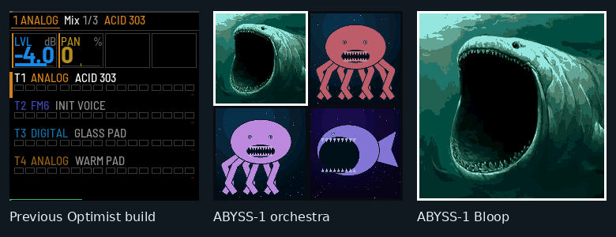

# ABYSS-1 Beta 1

[Play the beta at 60 MHz](https://abyss-one-fm1-simulator.aware-field-4307.chatgpt.site/?fw=abyss-1&embed=1&mhz=60) · [Download the tested FM-1 package](../builds/abyss-1-beta-1.fwsc) · [Player guide](MANUAL.md)

Build `98A6BF9D` is the first ABYSS emulator beta. The product owner is Gabor Varga, Zurich. The instrument opens on four sea creatures. Play a bass phrase with Bloop, turn SELECT to Kraken for percussion, and layer Julia and Space Bloop over it.

[Public evidence page and downloadable captures](https://abyss-one-fm1-simulator.aware-field-4307.chatgpt.site/beta-1/)

## Graphics evidence

[Watch the 40-second recording with emulator audio](../evidence/beta-1/monster-sound-demo.mp4). The same key plays each of the 16 sounds. After each track changes, HOME shows the four current assignments. Captions beneath the LCD identify panel inputs.




Left is the running four-part Optimist package from the earlier simulator. Centre and right are the beta package on the same emulator. Both packages booted from fresh flash. The images come from the emulated FM-1 LCD framebuffer. The comparison adds labels outside the three native 240 × 240 frames.

All 16 portraits and all four default orchestra tiles matched the source artwork after conversion to the firmware’s 16-colour RGB565 palettes. The check compared every interior pixel and excluded the three-pixel selection border. The manifest records the count for each image, SHA-256 hashes of the firmware packages, the emulator and every raw capture.

[All 16 native portraits](../evidence/beta-1/native-portraits.png) · [Mixer](../evidence/beta-1/mix-playing.png) · [Step editor](../evidence/beta-1/steps.png) · [Pixel counts and hashes](../evidence/beta-1/capture-manifest.json)

The Bloop picture is the supplied art. The other 15 are the prototype’s placeholder drawings. Character recognition and final art direction need a playtest.

## Playing the beta

1. Tap **Start**. The keyboard plays the creature with the white border.
2. Tap **REC**. The first note starts a 16-step loop. Play a phrase, turn **SELECT**, then play a second part. Tap **REC** again to leave the loop playing.
3. Tap **GLO** for the mixer. Turn **SELECT** to move between parts. Tap **SCL** to mute or unmute. **K1** sets level. **K2** sets tempo.
4. Tap **HOME** to see the orchestra, then **SCL** for the selected portrait. **PRESETS** changes creature within its family. **ALGORITHM** changes family. **K1–K4** shape size, mood, voice and depth. A short coloured bar shows the macro value.
5. Tap **SEQ** for steps. Turn **SELECT** to the desired step. Play a key to add a note or tap **EDIT** to clear the step. Tap **FX** to toggle minor-pentatonic scale lock for the whole orchestra.
6. Tap **PLAY** to stop, then **SAVE**. The white save mark confirms the write. Restart the same firmware package to resume the stored composition.

Wired MIDI note velocity sets the attack level. Channel aftertouch changes the held voice’s timbre. Holding a vocal note and increasing pressure moves its vowel. For a physical FM-1, **ENV** toggles the base platform’s contact sensing while all keys are released. The analog rows support strike velocity and pressure. The highest seven keys support strike velocity. The default digital keyboard mode works in the bundled browser emulator.

## Acceptance and limits

The tests exercise the compiled .fwsc by sending hardware matrix and encoder events, reading the LCD and measuring the audio output. Both 60 and 100 MHz runs covered portraits, all four keyboard voices, four recorded parts, mute and solo isolation, step entry and erase, and a saved two-track loop across a full chip reboot. Separate tests use deterministic repeated runs to measure the effect of wired velocity and aftertouch. The host simulation feeds modeled contact readings through ABYSS to check physical-key expression.

[60 MHz results](../evidence/beta-1/emulator-60mhz.log) · [100 MHz results](../evidence/beta-1/emulator-100mhz.log) · [Contact model](../evidence/beta-1/key-sensing.log) · [Build and radio configuration](../evidence/beta-1/build.log)

All 64 track/creature assignments produced their expected portrait and an audible keyboard note. This run used the emulator’s newer UC25HQ80 flash model and also restored the saved loop after reboot. [Assignment and flash results](../evidence/beta-1/all-assignments-new-flash.log)

A continuous four-creature loop ran for 600.135 emulated seconds at 60 MHz. The emulator returned all 26,476,544 requested stereo frames, reported zero refill starvation events during the run and zero second-core faults. These measurements are for the emulated chip. [Ten-minute soak log](../evidence/beta-1/four-track-soak.log)

Physical FM-1 key feel, speaker balance, hardware save/recovery, and Samsung S22 timing remain unverified for this beta. Held pressure shapes live sound. Continuous pressure curves are not stored in the loop. The 16 patches are initial sound designs. Children have yet to test the controls or portraits.

## Reproduce the captures

From the repository root with Node 22+, Python 3 and Pillow, run the following against the distributed packages.

```sh
mkdir -p out/beta-captures out/beta-proof
ABYSS_CAPTURE_DIR=out/beta-captures node scripts/test-creatures.mjs simulator builds/abyss-1-beta-1.fwsc
python3 scripts/beta-graphics.py out/beta-captures out/beta-proof builds/abyss-1-beta-1.fwsc builds/four-part-formant.fwsc
ABYSS_SOAK_SECONDS=600 node scripts/test-creatures.mjs simulator builds/abyss-1-beta-1.fwsc
ABYSS_NEW_FLASH=1 ABYSS_ALL_ASSIGNMENTS=1 node scripts/test-creatures.mjs simulator builds/abyss-1-beta-1.fwsc
```

To exercise modeled key sensing after building the cross target, run:

```sh
python3 scripts/build-creatures.py work/creatures --host
python3 scripts/test-key-sensing.py work/creatures/fm1base/optimist/build/host/optimist_host
```
