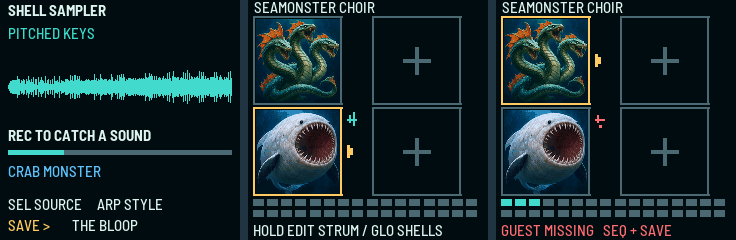
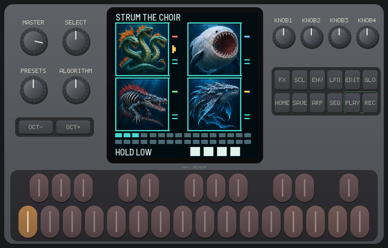
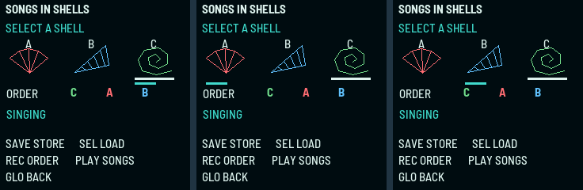
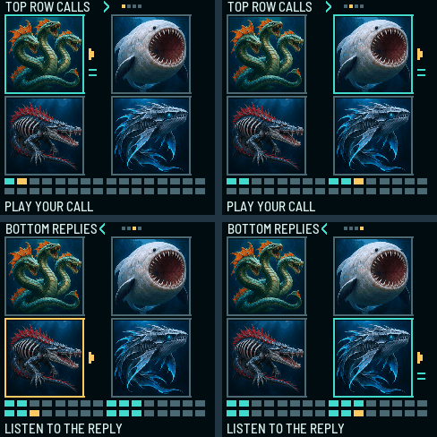
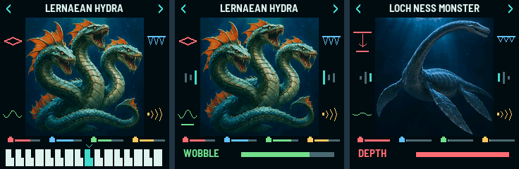

# Seamonster Choir 2.4.0 beta — player manual

**Make your first exchange.** Start the [browser instrument](../README.md) or switch on an FM-1 running this beta. From a fresh solo screen, press **ARP**, play two short notes, then lift both fingers. Hydra calls in the first bar. Bloop answers in the next. Leave a gap between the notes and listen for the same gap in the answer.

**SELECT** is the rotary knob beside MASTER. **SEL** is a separate button on the right, labeled **SCL** on the simulator. **PLAY** means the physical **PLAY/STOP** button. In this guide, count **white keys** along the long bottom row of 16, starting at the left. The shorter raised keys above them are separate expressive keys.

| If you want to… | Start here |
|---|---|
| Pick a voice, make it growl or dive | [Shape the voice](#shape-the-voice) · [Dive underwater](#dive-underwater) |
| Build four singers and trade two calls for two replies | [Pick four singers](#pick-four-singers) · [Trade calls](#trade-calls) |
| Make Bloop sing a sound of your own | [Give Bloop your sound](#give-bloop-your-sound) · [Load audio from a computer](#load-a-sound-from-a-computer) |
| Bring the four singers in one by one | [Strum the choir](#strum-the-choir) |
| Make a loop and arrange three songs | [Loop a phrase](#loop-a-phrase) · [Put three songs in shells](#put-three-songs-in-shells) |
| Work out why a control did something unexpected | [Controls by screen](#controls-by-screen) · [Troubleshooting](#when-something-sounds-wrong) |

The pictures below are captures of this firmware running in the FM-1 simulator. For an audible example, the 23-second recording starts with a forward and reverse strum, then plays a sampled reply and three saved songs. [Watch and listen](../evidence/choir/2.4.0/ensemble.mp4)

## Give Bloop your sound

1. From a fresh solo screen press **ARP**, then **PLAY** to leave the game with Hydra and Bloop seated. Turn **SELECT** two seats to bottom-left Bloop. On an existing choir, select the seat you want to use.
2. Press **SEQ** to open Shell Sampler. Turn **PRESETS** until **CRAB MONSTER** appears under the waveform. If the source reads **USB AUDIO**, tap **SEL** to switch it back.
3. Press **REC**, play a short click and press **REC** again. Check the waveform and press **PLAY** to audition it. At the bottom, **SAVE > THE BLOOP** identifies the singer that will receive it.
4. Press **SAVE**. The four-seat choir returns, with a small cyan waveform beside Bloop. To keep the arrangement in shell A, press **SAVE** again on this choir screen after stopping playback and releasing the keys.

Press **ARP**, play your call and release the keys. Bloop answers in your rhythm with the captured sound. Higher notes play the clip faster. Choose any other seat before opening the sampler to move the guest there. One choir seat can use the sample at a time. Recording into the sampler again leaves the assigned clip available until you assign another. To give the seat its original synth voice back, select it, open **SEQ**, press **EDIT**, and return with **SEQ**.

A song remembers the guest seat. The audio clip lives in RAM. After power-off the red marker and **GUEST MISSING** identify the silent seat. Load the clip again in SEQ and press SAVE to reattach it. You can also use an uploaded sound. [Load a sound from a computer](#load-a-sound-from-a-computer)

## Strum the choir

From the stopped choir with all keys up, hold **EDIT** for just over half a second until **STRUM THE CHOIR** appears. Hold one of the eight leftmost white keys. Sweep the four rightmost white keys. From left to right they play the top-left, top-right, bottom-left and bottom-right portraits. Sweep backwards or pause between two singers. Each synth singer sustains while the same root stays down. A sampled guest plays to the end of its clip. Tap a pad again to rearticulate it, or lift the root to release everyone. Empty seats stay quiet. Hold EDIT again for one-key harmony. REC, ARP and PLAY also leave strum mode.

| White keys | What your hand does |
|---|---|
| 1–8 | Hold any one with your left hand to choose the chord root. |
| 9–12 | Leave these four middle keys free in strum mode. |
| 13, 14, 15, 16 | Tap top-left, top-right, bottom-left and bottom-right respectively. The color beside each portrait matches its pad on the LCD. |

**Try bringing Bloop in last.** Find its portrait first. If Bloop is bottom-left, hold a root and tap white keys **13, 14, 16**, pause, then **15**. Lift the root and repeat. Moving to a new root clears the previous entries.

## Put three songs in shells

While the choir is stopped, release the keys and hold **GLO** for just over half a second. The scallop, conch and spiral are three separate song slots. **SELECT** moves the underline. **SAVE** stores your working song in that shell, replacing its previous contents. **SEL** loads the highlighted song and returns to the choir. **GLO** or **HOME** leaves the shelf with your working song.

Tap one of the **first three white keys** to hear one pass of its saved song. To make an order, press **REC**, then tap three occupied shells on those same keys. For **C → A → B**, tap the third, first and second white keys. Repeated shells are allowed. The third tap saves the order. **PLAY** performs the three songs once, 32 steps each. Press PLAY again to stop early. Both preview and chain playback return you to your working song.

**Try it by ear.** Record two short low notes and save them in A. Record one high note and save it in B. Choose a different monster, record a third phrase and save it in C. Preview them with the three lowest white keys. In the pictures, the white underline stays under your selected shell and the shorter cyan bar shows which shell is playing. A full C–A–B performance lasts 14.4 seconds, including any rests you recorded.

A quick SAVE or GLO on the choir screen still writes or recalls **A**, including a favourite made by an earlier version. All three arrangements and their play order survive power-off. A guest seat remembers which clip belongs there. To keep a guest recording across power cycles, keep the original audio file on your computer.

## Trade calls

Tap **Start** in the [player](../README.md). From a fresh solo screen, press **ARP** and play two notes as Hydra. In the second bar Bloop answers with your pitches and rhythm. The next note you play in a new calling bar starts another exchange.

With four occupied seats, the first note starts the clock. The top-left singer gets beats 1–2, then the top-right gets beats 3–4. In bar two, the bottom-left answers the first call and the bottom-right answers the second. Follow the gold marker and leave gaps for the replies. A row with one singer gives that monster all four beats. If the lower row is empty, ARP adds a partner.

| When | What to do or listen for |
|---|---|
| Bar 1, beats 1–2 | Play two low taps for the top-left singer. Leave a rest. |
| Bar 1, beats 3–4 | Give the top-right singer one longer, higher note. |
| Bar 2, beats 1–2 | Lift your fingers. Bottom-left repeats the two low taps and their rest. |
| Bar 2, beats 3–4 | Bottom-right answers with the longer high note. |

A new nonempty call replaces the participating singers’ lines. PLAY stops the game and PLAY again loops the completed exchange. EDIT restores the previous arrangement’s musical parts after the game stops.

## Pick four singers

Press **HOME** for the four portrait seats. From a fresh choir, tap **SEL** three times to invite three different partners. To choose them yourself, turn **SELECT** to a seat, then turn **PRESETS** or **ALGORITHM**. Each turn seats the portrait immediately. Changing a monster keeps its phrase. At rest, hold one white key for a harmony. During ordinary loop playback, the keyboard plays the selected seat over the others. OCT− and OCT+ shift the live keyboard an octave.

## Shape the voice

On the solo screen, turn SELECT, PRESETS or ALGORITHM to browse. Each position selects one portrait and its voice. Change creatures with your fingers off the keys to hear a short audition. Hold several white keys to play up to four notes of the same creature. OCT− and OCT+ move the register one octave below or above the middle setting.

K1 opens the mouth, K2 adds teeth, K3 adds wobble and K4 adds cave echo. In the choir each seat remembers its own settings. A paired raised key bends a held white note. Hold both for up to 0.7 seconds to open and roughen the sound. Releasing the raised key takes you back to the white note.

For continuous force on a physical keyboard, press ENV with all keys released. Let the note settle, then lean into it or ease off. The lower 20 keys support held pressure. The highest seven use the other gestures. Press ENV again with all keys up to return to normal scanning. The browser’s paired-key gesture can be played with two keyboard keys.

## Dive underwater

Hold a note, press **FX**, then turn the four knobs. The sea affects the whole instrument, including a playing choir. Turn a knob fully left to remove that effect. Press **FX** again to edit Mouth, Teeth, Wobble and Cave. The sea settings continue to sound while you edit the voice. **LFO** opens the sea controls with Current highlighted.

| Knob | What you hear |
|---|---|
| K1 · Depth | Synth voices glide down by up to an octave and the mix loses brightness. In the sampler, the clip slows as you descend. An assigned guest keeps its keyboard pitch and shares the darker filter. |
| K2 · Anger | Drive and clipping turn the voice into a rougher, more harmonically rich growl. |
| K3 · Current | A short moving delay sweeps through the note, with a wider swirl in stereo. |
| K4 · Cavern | Reflections build into a dark stereo tail that continues after you release the key. |

The choir favourite stores all four sea settings. The 32-step lanes record each singer’s voice controls. Sea controls are shared across the song. The solo gesture recorder also captures live sea-knob movements.

## Catch a sound

Press **SEQ** from a solo monster or the choir. Shell Sampler starts with a playable bubbling chirp. The leftmost white key plays it at its recorded pitch. Higher keys speed it up, and OCT− takes it lower. PLAY auditions a clip. Press SEQ again to return to where you were.

1. With a monster’s name beneath the waveform, press **REC** and play a key. Turn PRESETS to pick a different source monster. Capture begins on the first audible sound.
2. Press **REC** again to finish, or let the two-second recording fill. The waveform shows the new clip. A silent or cancelled recording keeps the preceding clip.
3. Press **ARP** to cycle through **Pitched Keys**, **Backwards** and **Four Slices**. In Four Slices the first four white keys play the four quarters of the clip. The pattern repeats across the keyboard. The four sea knobs colour sample playback.

The sampler holds one mono clip in RAM at 11,025 samples per second. It plays one sample voice at a time. Switching out of the sampler keeps the clip for this session. Switching off reloads the starter chirp. **SAVE in the sampler assigns the clip and returns to the choir. SAVE in the choir writes the arrangement and sea settings to shell A.** Keep original recordings on the computer.

### Load a sound from a computer

**Transfer an audio file.** Download [sample-loader.html](../tools/sample-loader.html) using GitHub’s download button and open the saved file in a browser with Web MIDI SysEx support. Connect USB, press SEQ on the FM-1, click **Find MIDI ports** and select the FM-1 for both directions. Choose the file and starting second, then **Send to sampler**. Wait for **Clip received** before playing. The loader uses the first two seconds from your chosen start and checks the completed transfer. If the browser requires a local web server, run `python3 -m http.server 8000` in the folder containing the downloaded file and open `http://localhost:8000/sample-loader.html`.

**Capture computer playback.** With the FM-1 connected by USB, choose its audio output in the computer’s sound settings. In Shell Sampler, press SEL until **SOURCE: USB AUDIO** appears. Press REC, play a short sound on the computer, then press REC again. SEL switches back to the monster source. To record somebody’s voice, use the computer’s microphone to make a sound file first. The FM-1 manual identifies the two 3.5 mm sockets as audio out and MIDI in. [FM-1 manual, rear panel](https://m.media-amazon.com/images/I/A1f3AttkBFL.pdf).

For scripted WAV transfers, [load-sample.py](../scripts/load-sample.py) lists ports with `--list` and accepts `clip.wav --out-port "…" --in-port "…"`. Install its optional dependencies with `python3 -m pip install mido python-rtmidi`. The browser loader and the script use the same acknowledged transfer protocol.

## Loop a phrase

In the choir, REC arms the selected seat. The first note starts two bars of 4/4 at 100 BPM. Two rows of 16 lights show the 32 sixteenth notes. A quick tap occupies one cell. Hold a note across cells to sustain it. Bends, pressure and the four knob settings are sampled while notes sound. REC again finishes early and leaves the remaining cells silent. The transport keeps going.

Select another singer and press REC. The new part starts on the next downbeat while the other parts play. A nonempty pass replaces the focused part. An empty pass keeps it. EDIT undoes the last committed take. For a call and answer it restores every participating part. PLAY stops or restarts the group from the beginning.

## Keep a favourite

Press SAVE in choir mode to keep the current portraits, settings and musical parts in shell A. Stop the transport and release the keys if SAVE is waiting. Watch for **SAVED**. GLO recalls that favourite while stopped with the keys up. Booting the same package and pressing HOME also restores it. A later successful save replaces the previous favourite. Browser storage belongs to that browser and firmware package.

The large solo screen also retains its original REC/PLAY gesture recorder. It replays a single take once and clears on power-off. Use HOME for the repeating four-part recorder.

## Controls by screen

| Screen | REC | PLAY | SAVE |
|---|---|---|---|
| One large monster | Start or finish a solo take. The first note or audible audition starts timing. | Replay the take once. With no take, audition the monster. | Use HOME to reach choir saving. |
| Four choir seats | Arm the selected seat. Start with a note, or wait for the next downbeat during playback. | Start all recorded lanes from step one or stop them together. | Write shell A when the transport is stopped and the keys are up. |
| Shell Sampler (SEQ) | Capture the selected source, then tap again to finish early. | Audition the current clip. | Assign this clip to the destination shown and return to the choir. |
| Songs in Shells (hold GLO) | Choose three occupied shells with the first three white keys to set the play order. | Play the order once or stop the preview or chain in progress. | Overwrite the highlighted song with the working arrangement. |

A solo take holds up to 30 seconds or 512 changes of gesture, whichever comes first. Playing again during a solo replay lets you take over. The 32-step choir recorder stores performed notes, rests, bends, pressure and the singer’s four voice knobs in its lane. Its timing grid is 150 ms per step. To keep a recorded choir between sessions, stop playback, release the keys and save it to a shell.

## When something sounds wrong

| What you notice | What to check |
|---|---|
| The third singer seems to vanish as you move to the fourth. | Turn SELECT to move the gold marker. Turn PRESETS or ALGORITHM to change the singer **under** that marker. After moving away, the previous portrait should still be visible. |
| The low key is silent in strum mode. | Keep it held and tap one of the four rightmost white keys for an occupied seat. A root by itself waits for the first singer. |
| The clip played backwards in the sampler but sings forwards in the choir. | Backwards and Four Slices are sampler keyboard styles. The guest seat plays the assigned clip forwards at the recorded note’s pitch. |
| Bloop is silent after reboot. | Look for **GUEST MISSING**. Select Bloop, open SEQ, load or capture the clip again, and press SAVE to attach it. |
| A shell preview works, but PLAY shows **EMPTY SHELL**. | Preview needs only the shell you tapped. PLAY needs all three positions in the order to point to occupied shells. With only A filled, try shelf REC and tap A three times. |
| The recording plays once, or stops sooner than expected. | The large portrait replays a solo take once. Use HOME and the four-seat recorder for a continuous 32-step loop. Shelf PLAY ends after three complete phrases. |

[Play or download](../README.md) · [Feature definition](FEATURES.md) · [Measured results and physical UAT](MONSTER-KEYS.md)
